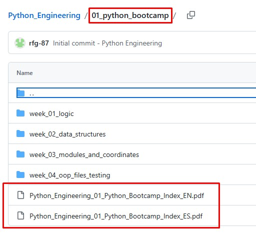
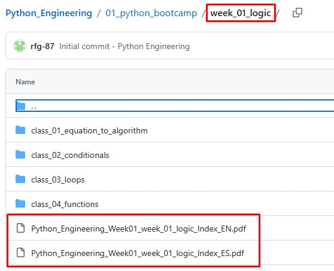
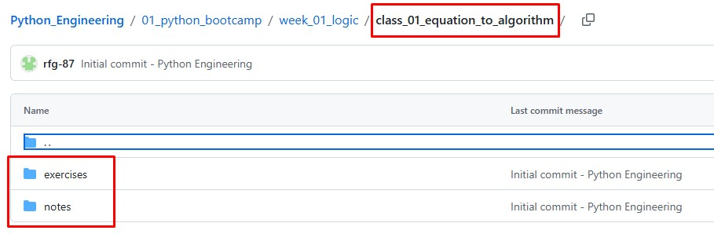
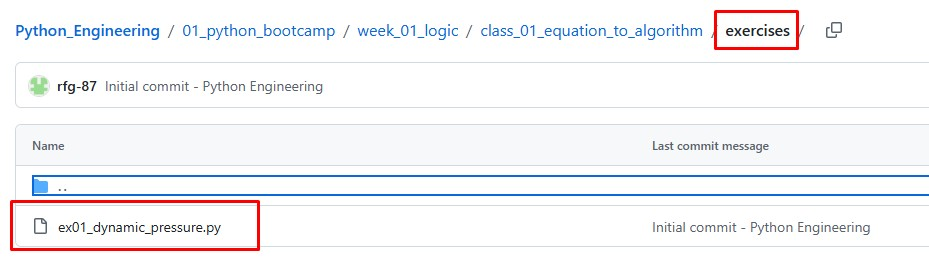

# Python Engineering

This is a self-made course combining the basis of Python and Engineering theory. 

It is intended to take 3 months to finish. But my recommendation is to take your time, do not rush, understand what you are doing and spend the time patiently. If it takes 4 months, is ok. If it takes 6 months it is also ok. This is for you and I and to try to enjoy while doing in order to learn and mix skills: programming and engineering...and it takes time ;)

To do so, the course is split into several steps that we are going to explore through the different folders:

- 00_admin
- 01_python_bootcamp
- 02_numerical_methods
- 03_aircraft_dynamics
- 04_propulsion
- 05_astrodynamics
- 06_rocket_dynamics
- 90_portfolio
- 99_sandbox

The "00_admin" is a general folder containing information about an overview of the roadmap.

The "99_sandbox" is a folder where you can put some experimental or trash code that you want to test before putting the final version into the corresponding folder.

## Current status

- [x] 00_admin
- [x] 01_python_bootcamp
- [ ] 02_numerical_methods
- [ ] 03_aircraft_dynamics
- [ ] 04_propulsion
- [ ] 05_astrodynamics
- [ ] 06_rocket_dynamics
- [x] 99_sandbox

## 00_admin folder
Inside you will find:

- _images/
  - images used in the Readme.md file.

- resources/vscode
  - .pdf on how to debug through VS Code terminal.
  - Note: You can also use a launch.json file to run and debug.

- roadmap/
  - .pdf with a general overview of the course.

## Programming language

For the programming part:

- It is intended to start from scratch.
- If you need some help, you can use AI for further explanations or more exercises.

## Engineering theory

For the engineering part:

- Some technical and mathematical knowledge is recommended:
  - Derivative.
  - Integral.
  - ODE.
  - Statistics.
  - Algebra.
  - Physics.

## Languages

The course .pdf files are in:

- English
- Spanish

The code annotations and questions are in:

- English

## How to use it

Inside each of the folders there are some .pdf documents overviewing what you will see inside of them. 

And inside these folders there are subfolders with a more specific roadmap-summary for each of the subjects that you will learn. 

In addition, you will find into the previous subfolders the folders for each of the classes, where you find:

- exercises
- notes
- mini_project (in some cases)

Inside "exercises" you will have to put the .py file of your solution scripted. Remember that in programming there is not only one way to write down the code and find a solution.

And in notes, you will find the .pdf file containing the statement of the exercise and some extra .pdf explaining with more detail what is intended to learn, such as Python commands or Engineering theory.

In that sense, you have those .pdf summaries in case you have to come back to review something. And you will do, for sure, as it happened to me (and still happens). Little by little the river shapes the stone.

The statement of the exercice in .pdf will have a name similar to:

"Python_Engineering_EX05_Loops_Sum_of_Squares_EN.pdf"

And so for the mini projects:

"Python_Engineering_MiniProject01_Ballistic_Flight_Simulator_EN.pdf"

The other .pdf files that you find inside notes are intended to expand and concrete what you are learning in the exercise.

## Important remark

In the first 3 weeks, please lean on the .py codes that are already in the exercises to replicate them and understand the first steps.

- [ ] Making documentation week_01 - week_03: ongoing

## Python version used

The .py files have been done into an Anaconda (conda) interpreter and profile using Python version 3.9.12.

Anaconda is a pre-packaged bundle containing Python, R, and major data science tools.